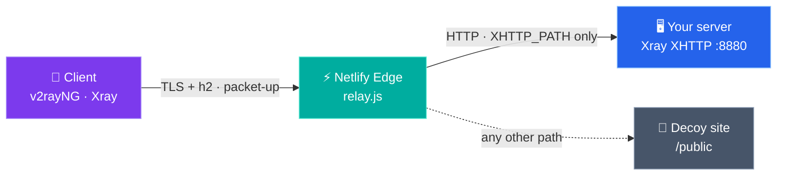

<div align="center">

# NetlifyRelay

**Relay Xray VLESS + XHTTP through a Netlify Edge Function — with the three fixes that actually make it work.**

[](LICENSE)


[English](README.md) · [فارسی](README.fa.md)

</div>

---

## How it works



- One ~60-line Edge Function, no build step, no dependencies.
- Only requests under `XHTTP_PATH` are relayed; everything else serves a harmless static page.
- Works with a custom domain and with clean Netlify edge IPs.

## Why most Netlify XHTTP setups fail

Tested end-to-end with Xray-core 26.6.1 in November 2026:

| Problem | Symptom | Fix in this repo |
|---|---|---|
| Netlify's WAF blocks requests whose `Referer` contains `x_padding=` — Xray's default padding location | `429 Too Many Requests` on every request → client shows `EOF` | Move padding into a custom header: `xPaddingObfsMode` + `xPaddingPlacement: header` |
| Netlify buffers streaming request bodies | `stream-up` / `stream-one` connect but no data flows | Client uses **`packet-up`**, server stays on `auto` |
| `*.netlify.app` is filtered on some networks | TLS `EOF`, or a block page over plain HTTP | Attach your own (sub)domain to the site |

## Quick start

### 1. Server — Xray inbound

Create a VLESS inbound with these stream settings (full examples in [`examples/`](examples)):

```json
"streamSettings": {
  "network": "xhttp",
  "security": "none",
  "xhttpSettings": {
    "path": "/your-secret-path",
    "host": "",
    "mode": "auto",
    "xPaddingBytes": "1-1",
    "xPaddingObfsMode": true,
    "xPaddingKey": "t",
    "xPaddingHeader": "X-Trace",
    "xPaddingPlacement": "header"
  }
}
```

- **3x-ui:** Inbounds → Import → [`examples/3x-ui/inbound-import.json`](examples/3x-ui/inbound-import.json)
- **Plain Xray:** [`examples/xray/server.json`](examples/xray/server.json)
- Leave `host` empty — the relay strips the `Host` header.
- Open the inbound port (e.g. TCP `8880`) in your firewall / cloud security group.

### 2. Netlify — deploy the relay

Fork this repo and import it in Netlify (**Add new project → Import from Git**), or zip the repo and use **Deploy manually**. No build command; publish directory is `public`.

Then set **Site configuration → Environment variables**:

| Variable | Example |
|---|---|
| `BACKEND_URL` | `http://203.0.113.10:8880` (no trailing slash) |
| `XHTTP_PATH` | `/your-secret-path` |

Trigger a new deploy so the function picks them up.

### 3. Custom domain (recommended)

1. Netlify → **Domain management → Add domain** → `relay.example.com`
2. DNS: `CNAME relay → <site>.netlify.app` (Cloudflare: **DNS only**, grey cloud)
3. Wait for Netlify to issue the Let's Encrypt certificate.

Check it:

```sh
curl -I https://relay.example.com/                       # 200 → decoy site
curl -s -o /dev/null -w '%{http_code}\n' https://relay.example.com/your-secret-path/x   # 400 → relay reaches Xray ✔
```

### 4. Client

```text
vless://UUID@relay.example.com:443?encryption=none&security=tls&sni=relay.example.com&fp=chrome&alpn=h2&type=xhttp&host=relay.example.com&path=%2Fyour-secret-path&mode=packet-up&extra=%7B%22xPaddingBytes%22%3A%221-1%22%2C%22xPaddingObfsMode%22%3Atrue%2C%22xPaddingKey%22%3A%22t%22%2C%22xPaddingHeader%22%3A%22X-Trace%22%2C%22xPaddingPlacement%22%3A%22header%22%7D#netlify-xhttp
```

Or generate one: `./examples/client/make-link.sh <uuid> relay.example.com /your-secret-path [clean-ip]`

> The client needs a recent Xray core (26.x) that understands `xPaddingObfsMode`. Older cores ignore it, fall back to the Referer and get `429`.

## Clean IPs

Any reachable Netlify edge IP can replace the address; keep **SNI** and **Host** on your domain:

```sh
curl -sI --resolve relay.example.com:443:<IP> https://relay.example.com/   # HTTP/2 200 → usable
```

## Subscriptions (3x-ui)

3x-ui **v3.4+** exports XHTTP `extra` (including the padding-obfs fields) and per-host SNI through the **Hosts** page, so links in the subscription work out of the box. Older panels don't — share the link manually.

## Troubleshooting

See [`docs/troubleshooting.md`](docs/troubleshooting.md).

| You see | Meaning |
|---|---|
| `429` | Padding is still in the `Referer` — check the client's `extra` / core version |
| `400` on `/<path>/x` with curl | Normal: relay and Xray are both alive |
| `404` on the path | Env vars missing, or no redeploy after setting them |
| `502` | Backend port closed or wrong `BACKEND_URL` |
| Connects, no traffic | Client mode is `stream-up`/`stream-one` — switch to `packet-up` |

## Repository layout

```
├── netlify.toml                  # publish /public, run relay on /*
├── netlify/edge-functions/
│   └── relay.js                  # the relay
├── public/index.html             # decoy page
├── examples/
│   ├── 3x-ui/inbound-import.json
│   ├── xray/server.json
│   └── client/{client.json, share-link.txt, make-link.sh}
└── docs/troubleshooting.md
```

## Disclaimer

Using a hosting platform as a traffic relay may violate its terms of service and can get your site or account suspended. The free plan is credit-based, and `packet-up` creates many requests — watch your usage. Keep this as a secondary route, use unique names and paths, and follow the laws where you live.

## License

[MIT](LICENSE) © 2026 Amirali
